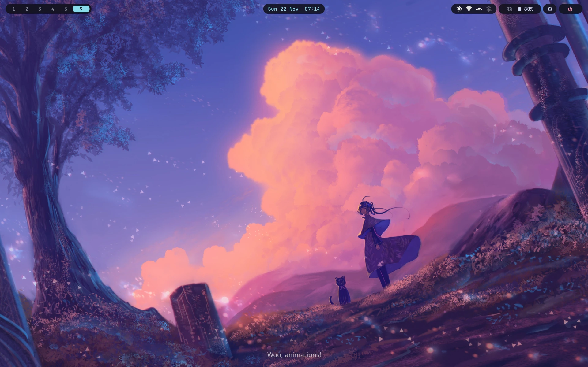
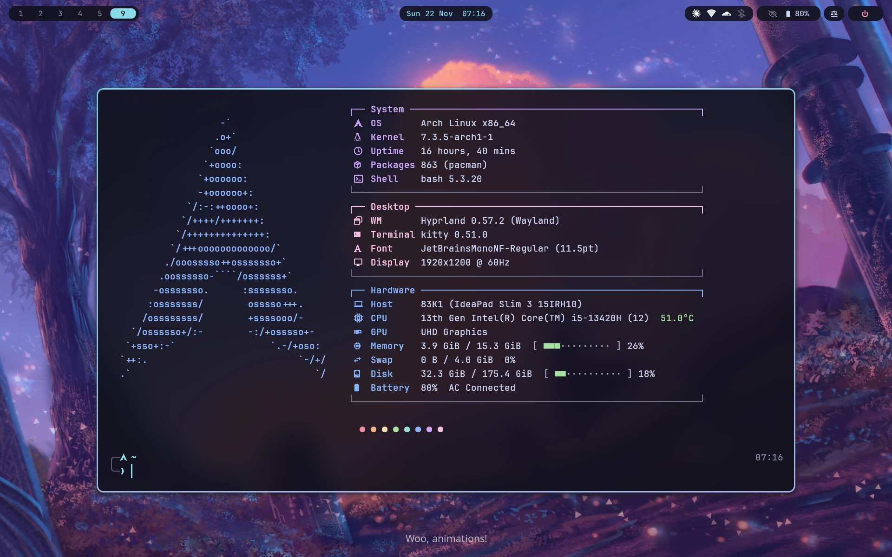
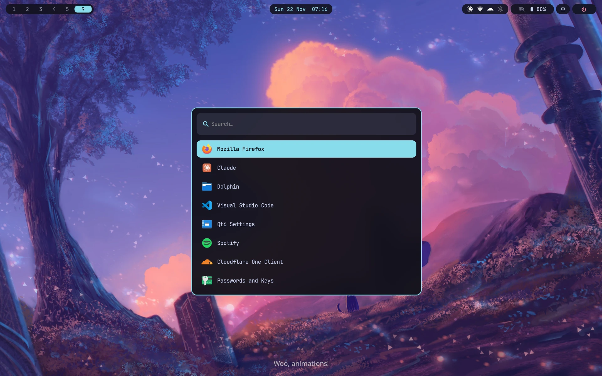
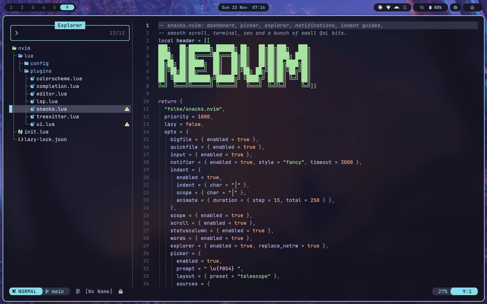
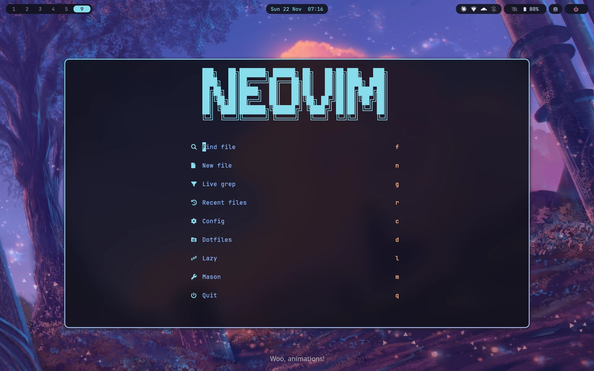
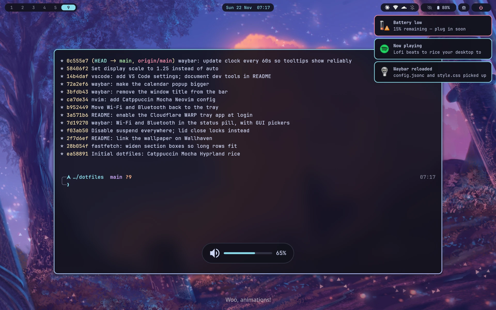
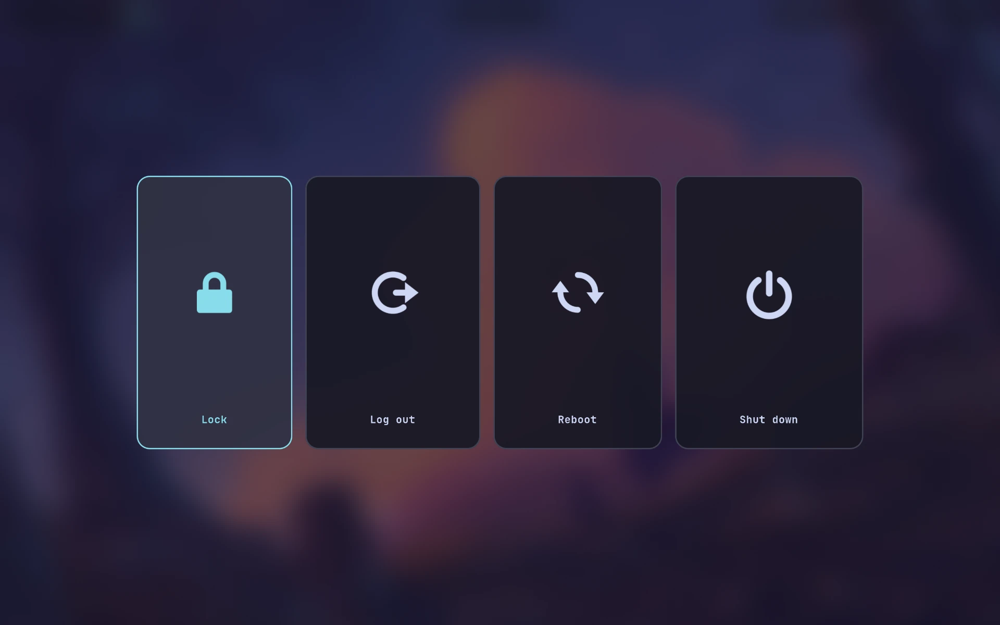
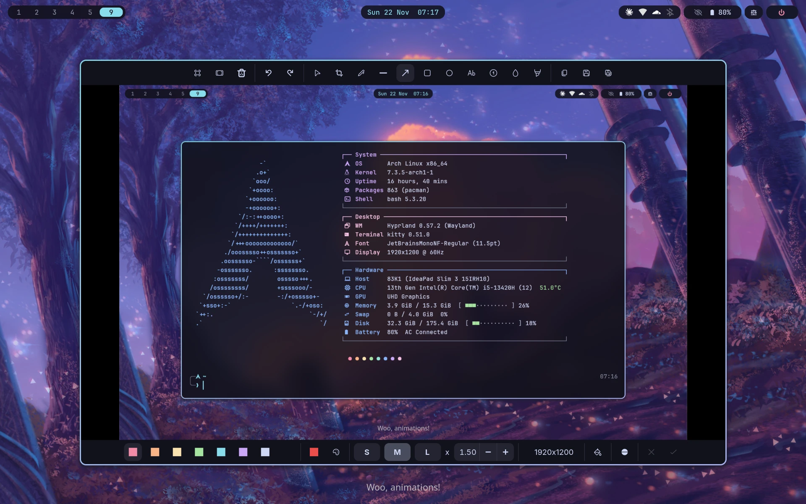

# dotfiles

Arch Linux + Hyprland rice, themed end to end in **Catppuccin Mocha** with a sky (`#89dceb`) accent.



| | |
|---|---|
| **WM** | Hyprland (Lua config) + hypridle / hyprlock / hyprpaper |
| **Bar** | Waybar |
| **Launcher** | wofi |
| **Notifications** | dunst |
| **OSD** | SwayOSD (volume / brightness pop-ups) |
| **Power menu** | wlogout |
| **Wi-Fi / Bluetooth** | nm-applet / blueman, in the waybar tray |
| **Screenshots** | grim + slurp → satty |
| **Terminal** | kitty |
| **Editor** | Neovim (lazy.nvim, Catppuccin, snacks, blink.cmp, Mason LSP) |
| **Shell** | bash + starship, eza, bat, fzf, zoxide |
| **GTK** | adw-gtk3-dark + Catppuccin colour overrides |
| **Qt** | Kvantum `catppuccin-mocha-sky` via qt6ct |
| **Cursor** | Catppuccin Mocha Dark |
| **Icons** | Papirus-Dark |
| **Font** | JetBrainsMono Nerd Font |

### Dev tools

| | |
|---|---|
| **Editors** | VS Code (`$VISUAL`, Catppuccin Mocha sky to match the rice), Neovim |
| **AI** | Claude Desktop, Claude Code (`claude` CLI), opencode (desktop app + `opencode` CLI) |
| **VCS** | git, GitHub CLI (`gh`) |
| **Containers** | Docker + buildx + compose |
| **C / C++** | gcc (base-devel), clang, cmake, ninja, bear, lldb, valgrind |
| **Python** | uv, pipx, pip, ipython, pytest, ruff, pyright, debugpy |
| **Go** | go, gopls, delve, golangci-lint, staticcheck, go-tools, bootdev CLI (`go install`) |
| **JS / TS** | Node.js, npm, pnpm, TypeScript, ESLint, Prettier |
| **Neovim LSPs** (Mason) | lua_ls, bashls, clangd, basedpyright, gopls, jsonls, ts_ls |

## Screenshots

| | |
|---|---|
|  |  |
| **kitty** + starship, with fastfetch | **wofi** launcher (`Super+R`) |
|  |  |
| **Neovim**: snacks explorer, Catppuccin, lualine | **Neovim** dashboard |
|  |  |
| **dunst** notifications + **SwayOSD** volume pop-up | **wlogout** power menu (`Super+Escape`) |
|  | |
| **satty** screenshot editor (`Print`) | |

## Layout

Each top-level folder is a [GNU Stow](https://www.gnu.org/software/stow/) package that mirrors `$HOME`:

```
hypr/       → ~/.config/hypr          (hyprland.lua, hypridle, hyprlock, hyprpaper, scripts/)
waybar/     → ~/.config/waybar
kitty/      → ~/.config/kitty
nvim/       → ~/.config/nvim          (lazy.nvim; plugins install on first launch)
vscode/     → ~/.config/Code/User/settings.json
wofi/       → ~/.config/wofi
dunst/      → ~/.config/dunst
fastfetch/  → ~/.config/fastfetch
wlogout/    → ~/.config/wlogout
swayosd/    → ~/.config/swayosd
satty/      → ~/.config/satty
kvantum/    → ~/.config/Kvantum
qt6ct/      → ~/.config/qt6ct
gtk/        → ~/.config/gtk-3.0, ~/.config/gtk-4.0
starship/   → ~/.config/starship.toml
bash/       → ~/.bashrc, ~/.bash_profile
kde-colors/ → ~/.local/share/color-schemes   (Catppuccin Mocha Sky scheme for Dolphin & other KDE apps)
cursor/     → ~/.local/share/icons/default   (fallback cursor theme)
```

## Install

```bash
# packages
sudo pacman -S --needed hyprland hypridle hyprlock hyprpaper waybar kitty wofi dunst \
  swayosd satty grim slurp cliphist wl-clipboard brightnessctl playerctl \
  adw-gtk-theme kvantum qt6ct papirus-icon-theme ttf-jetbrains-mono-nerd \
  starship eza bat fzf zoxide fd bash-completion fastfetch stow \
  bluez bluez-utils network-manager-applet blueman \
  neovim unzip tree-sitter-cli luarocks ripgrep
yay -S --needed wlogout kvantum-theme-catppuccin-git catppuccin-cursors-mocha

# dev tools
sudo pacman -S --needed base-devel git github-cli docker docker-buildx docker-compose \
  clang cmake ninja bear lldb valgrind \
  uv python-pip python-pipx ipython python-pytest ruff pyright python-debugpy \
  go gopls delve golangci-lint staticcheck go-tools \
  nodejs npm pnpm typescript eslint prettier opencode-desktop
yay -S --needed visual-studio-code-bin claude-desktop claude-code
go install github.com/bootdotdev/bootdev@latest   # lands in ~/go/bin, which .bashrc adds to PATH
sudo systemctl enable --now docker
# optional: run docker without sudo (log out and back in afterwards)
sudo usermod -aG docker "$USER"

# VS Code extensions
for ext in catppuccin.catppuccin-vsc catppuccin.catppuccin-vsc-icons \
  llvm-vs-code-extensions.vscode-clangd ms-vscode.cmake-tools vadimcn.vscode-lldb \
  ms-python.python ms-python.vscode-pylance ms-python.debugpy ms-python.vscode-python-envs \
  charliermarsh.ruff golang.go dbaeumer.vscode-eslint esbenp.prettier-vscode; do
  code --install-extension "$ext"
done

# link everything (back up any existing configs first)
git clone https://github.com/brokenCart/dotfiles ~/dotfiles
mkdir -p ~/.config/Code/User   # so stow links only settings.json, not VS Code's whole state dir
cd ~/dotfiles && stow */

# GTK settings that live in dconf
gsettings set org.gnome.desktop.interface gtk-theme 'adw-gtk3-dark'
gsettings set org.gnome.desktop.interface icon-theme 'Papirus-Dark'
gsettings set org.gnome.desktop.interface cursor-theme 'catppuccin-mocha-dark-cursors'
gsettings set org.gnome.desktop.interface color-scheme 'prefer-dark'
```

### Wallpaper

[wallhaven-yqkl97](https://wallhaven.cc/w/yqkl97) from Wallhaven. Download it to `~/Pictures/Wallpapers/wallhaven-yqkl97.jpg`, which is where `hypr/.config/hypr/hyprpaper.conf` looks for it.

### System settings (in `/etc`, not stowed)

Suspend is disabled on purpose: there's no suspend button in wlogout or waybar, hypridle never suspends, and closing the lid locks and blanks the screen instead (see the `Lid Switch` binds in `hyprland.lua`). That last part needs logind told to ignore the lid:

```bash
sudo mkdir -p /etc/systemd/logind.conf.d
printf '[Login]\nHandleLidSwitch=ignore\nHandleLidSwitchExternalPower=ignore\nHandleLidSwitchDocked=ignore\n' \
  | sudo tee /etc/systemd/logind.conf.d/no-lid-suspend.conf
sudo systemctl kill -s HUP systemd-logind
```

SDDM login-screen cursor, in `/etc/sddm.conf.d/theme.conf`:

```ini
CursorTheme=catppuccin-mocha-dark-cursors
```

Cloudflare WARP tray icon (`cloudflare-warp-bin`). The VPN daemon `warp-svc` starts at boot, but the tray app's login unit ships disabled, and Hyprland doesn't run desktop autostart entries:

```bash
systemctl --user enable --now warp-taskbar
```

## Keybinds

| Keys | Action |
|---|---|
| `Super+Q` | Terminal (kitty) |
| `Super+R` | App launcher (wofi) |
| `Super+E` | File manager (Dolphin) |
| `Super+C` | Close window |
| `Super+F` / `Super+Shift+F` | Fullscreen / maximize |
| `Super+V` | Toggle floating |
| `Super+L` | Lock screen |
| `Super+Escape` | Power menu (wlogout) |
| `Super+Shift+V` | Clipboard history |
| `Super+S` / `Super+Shift+S` | Scratchpad / send window to scratchpad |
| `Super+1…0` / `Super+Shift+1…0` | Switch / move to workspace |
| `Print` / `Super+Shift+Z` | Region screenshot → satty |
| `Shift+Print` | Full-screen screenshot → satty |
| `Ctrl+Print` | Region screenshot → clipboard |

## Editing

Configs in `~/.config` are symlinks into this repo, so just edit them in place and commit:

```bash
cd ~/dotfiles && git add -A && git commit -m "tweak waybar" && git push
```
